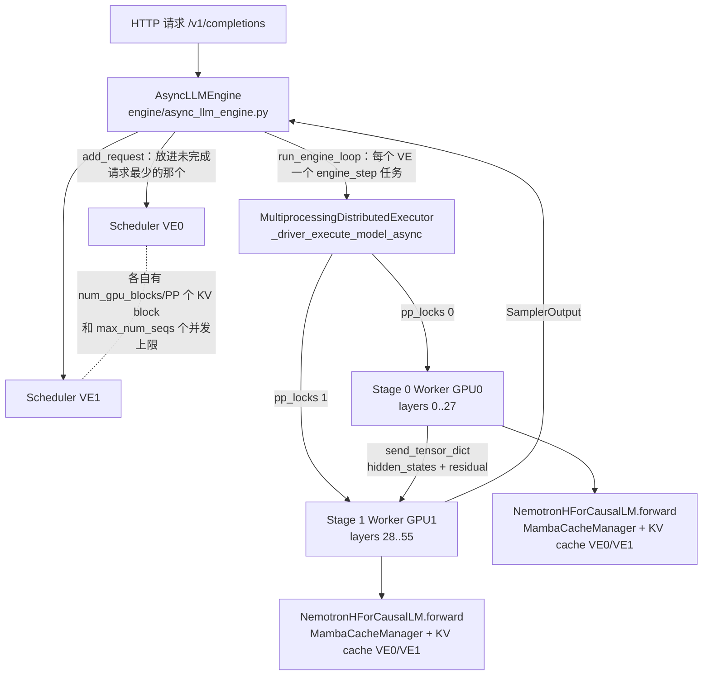

# vLLM v0.10.1.1（V0 引擎）PP 推理调用链笔记

对应 `docs/plan.md` 的阅读任务 2.1–2.6。行号以 `/venv/vllm010/lib/python3.12/site-packages/vllm/`（v0.10.1.1）为准。

## 总图



流水线靠 **virtual engine（VE）** 实现：PP=2 时有 2 个独立的 scheduler，各自产生 micro-batch。每个 stage 有一把锁，VE0 的 batch 在 stage 1 上算的时候，VE1 的 batch 可以在 stage 0 上算。同一个 VE 的下一步要等上一步采样出 token，所以每个 VE 同时最多只有 1 个 micro-batch 在流水线里。

## 2.1 模型结构

`config.json` 里的 `hybrid_override_pattern`（56 个字符，每个字符代表一层）：

```
M-M-M-MM-M-M-M*-M-M-M*-M-M-M-M*-M-M-M-M*-M-MM-M-M-M-M-M-
```

- Mamba（M）27 层，MLP（-）25 层，Attention（*）4 层，分别在第 **14、21、30、39** 层
- 每层 attention 的 KV：8 个 KV head × 128 维 × K/V 两份 × bf16 = **4 KiB / token**
- 每层 Mamba 的 state（`--mamba-ssm-cache-dtype float32`）：SSM state 128 头 × 80 × 128 × 4B ≈ 5.0 MiB，加上 conv state ≈ **5.1 MiB / 序列**，和上下文长度无关

## 2.2 层怎么切到各 stage

- `distributed/utils.py:89 get_pp_indices`：如果设置了 `VLLM_PP_LAYER_PARTITION` 就按它切；否则均分，余数加到倒数第 2 个 stage 往前的那些 stage 上（最后一个 stage 要算 norm 和 logits，所以尽量不给它多分）。
- `model_executor/models/utils.py:626 make_layers`：建一个长度为 56 的 `ModuleList`，本 stage 的位置放真实层，其他位置放 `PPMissingLayer`（531 行，forward 直接返回第一个参数）。这样做是为了让层号和 checkpoint 里的权重名字保持一致。
- 均匀切分时每个 stage 分到的 attention 层数：PP=2（28,28）是 **2 + 2**；PP=4（14×4）是 **0, 2, 2, 0**，首尾两个 stage 一层 attention 都没有。

## 2.3 每个 stage 怎么前向

1. `worker/worker_base.py:408`：非首 stage 先 `recv_tensor_dict` 收到上一个 stage 发来的 `IntermediateTensors`。
2. `model_runner.execute_model` → `NemotronHForCausalLM.forward`（`nemotron_h.py:574`）：第一次调用时**惰性创建** `MambaCacheManager`。
3. `NemotronHModel.forward`（369 行）：首 stage 做 embedding，非首 stage 从 `intermediate_tensors` 里取出 `hidden_states` 和 `residual`，然后逐层计算。每层（例如 296 行的 attention 层）是 pre-norm 写法：`norm(hidden, residual)` 融合了"残差相加 + RMSNorm"，层的输出只是增量，完整信号在 `residual` 里。
4. 非末 stage 返回 `IntermediateTensors({"hidden_states", "residual"})`，再由 `worker_base.py:434 send_tensor_dict` 发给下一个 stage；末 stage 做 `norm_f`、算 logits 和采样。
5. 这一段代码有 4 个 bug，见 `docs/findings.md`。

## 2.4 显存怎么算（显存浪费的直接证据）

- `worker/worker.py:233 determine_num_available_blocks`：
  - `profile_run()` 用 `max_num_batched_tokens` 个假 token 跑一次 forward，测出权重、非 torch 显存和激活峰值。Mamba cache 是在这次 forward 里惰性创建的，所以也被算进了"激活"。
  - `available_kv = total × gpu_memory_utilization − 非 KV 显存`（263 行）
  - `num_blocks = available_kv // cache_block_size`（273 行）；`cache_block_size` 为 0（本 stage 没有 attention 层）时直接返回 **0**（269 行）。
- `worker/cache_engine.py:121 get_cache_block_size`：`block_size(16) × 本 stage 的 attention 层数 × 2 × 8 × 128 × 2B`。所以 1、2、3 层 attention 的 stage，每个 block 分别是 64、128、192 KiB。
- `executor/executor_base.py:105`：`collective_rpc` 收集所有 worker 的结果，然后 **`min()`**，所有 stage 都按这个数分配 KV。
  - 结果：attention 少的 stage 每个 block 很小，本来能放更多 block，但被迫和瓶颈 stage 一样多，剩下的显存就浪费了。
  - 有 stage 没有 attention 层时，`min()` 等于 0，引擎无法启动（PP=4 均匀切分的情况）。

## 2.5 Mamba state 怎么管理

- `model_executor/models/mamba_cache.py:25 MambaCacheManager`：分配 `[本 stage 的 Mamba 层数, max_batch_size, ...]` 两个张量（conv state 和 SSM state）。
  - **只为本 stage 的 Mamba 层分配**：层数来自 `get_num_layers_by_block_type`，它按 `get_layers_start_end_indices` 只统计本 stage 的层。所以 forward 里要用本地编号 `mamba_idx`，不能用全局层号。
  - `max_batch_size = scheduler_config.max_num_seqs`（37 行）；不开 eager 时会向上补齐到 CUDA graph 的 batch 大小。
  - 是**预先按上限分配**的：哪怕实际只有 1 个并发，也会占 `max_num_seqs × 每序列的 state` 这么多显存。Nano 9B v2 一个 stage 有 13～17 层 Mamba，每个序列 66～86 MiB；`max_num_seqs=64` 时就是 4～5.4 GiB。
- 槽位由 `constant_size_cache.py` 管理：`free_cache_indices` 一共只有 `max_batch_size` 个。
  - ⚠️ 推测（未验证）：每个 VE 的 scheduler 各自允许 `max_num_seqs` 个并发，PP=2 时最多可能有 2 × `max_num_seqs` 个序列在跑，但 Mamba 槽位只有 `max_num_seqs` 个。到目前为止所有实验的并发数都 ≤ `max_num_seqs`，所以还没有触发。

## 2.6 调度：virtual engine 和 micro-batch

- `engine/llm_engine.py`（约 330 行）：PP 有几个 stage，就建几个 `Scheduler`（每个对应一个 VE）。
- `core/scheduler.py:442`：**每个 scheduler 只拿到 `num_gpu_blocks // PP` 个 block**；`worker/cache_engine.py:46` 里每个 VE 也各有一份 KV cache。所以单个 VE 能用的 KV 容量只有 `min()` 结果的 1/PP。
- `llm_engine.py:600`：新请求放进未完成请求最少的那个 scheduler。
- `engine/async_llm_engine.py:710 run_engine_loop`：每个 VE 一个 `engine_step` 任务，并发执行。
- `executor/mp_distributed_executor.py:205 _driver_execute_model_async`：对每个 stage 用一把 `asyncio.Lock`（`pp_locks`），把同一个 micro-batch 依次交给各个 stage 的 worker。同一个 stage 上同时只能跑一个 VE 的 batch，这就形成了流水线；最后返回末 stage 的输出。
- 含义：PP=2 时流水线里最多只有 2 个 micro-batch。任何一个 stage 慢了，另一个 stage 就要空等（也就是空泡），这正是 profiling 里忙碌率要量的东西。
